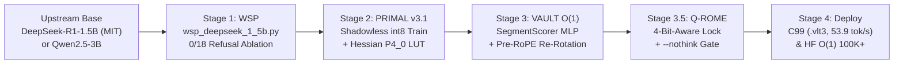

# VAULT v3 + PRIMAL + WSP: Discrete Full-Parameter Training, O(1) 100K+ KV Memory, Freestanding C99 Runtime & Direct Weight-Space Uncensoring

[](LICENSE)
[](docs/PIPELINE_GUIDE.md)
[](https://huggingface.co/batteryphil/VAULT-v3-3B-PRIMAL)
[](https://huggingface.co/batteryphil/VAULT-v3-DeepSeek-R1-1.5B-PRIMAL)

Complete reference implementation, freestanding zero-libc C99 engine (`x86_64 AVX2/FMA` + `Apple Silicon / ARM64 NEON`), shadowless discrete integer trainer (**`PRIMAL v3.1`**), Prime-Harmonic 4-bit quantizer (**`V3_P4_0`**), Weight-Space Programming (**`WSP` + `Q-ROME`**) uncensoring surgeon, and 1-command reproducible pipeline ([`run_pipeline.py`](run_pipeline.py) · **[Full Pipeline Guide](docs/PIPELINE_GUIDE.md)**) for **two complete model families**:

1. **`VAULT-v3-3B-PRIMAL` (`v3.1`, `3.09B` params):** Full-parameter discrete `int8` fine-tune of `Qwen2.5-3B-Instruct` trained at **`777.0 tok/s` inside `9.28 GiB` VRAM** on a single consumer **16 GB GPU (AMD Radeon RX 9060 XT)** without FP32/BF16 master weights or LoRA adapters, paired with fixed-budget **`O(1)` Segment-Evicted KV Memory** (`0.0 MiB` VRAM growth from `16K` to `100K+` tokens; **`94.19%` [`162/172`]** across VAULT `8K–100.5K` + external RULER `4K–64K`) and **`27.82 tok/s`** CPU inference in **`2.18 GiB` RSS**.
2. **`VAULT-v3-DeepSeek-R1-1.5B-PRIMAL` (`1.78B` params, upstream `MIT`):** Full end-to-end uncensored `PRIMAL v3.1` + `VAULT v3` edition of `DeepSeek-R1-Distill-Qwen-1.5B` — combining **Direct Weight-Space Uncensoring (`WSP` + Quantization-Aware Velvet `Q-ROME`, `0 / 18` violations + zero-latency `--nothink` mode)**, **shadowless discrete `PRIMAL v3.1` training (`1,233.4 tok/s` inside `5.94 GiB` GPU VRAM**, healing `WikiText-2` Word PPL `99.20 -> 60.60`), **exact 4-bit `V3_P4_0` Prime-Harmonic LUT math parity (`71.00%` `GSM8K-200` in both `Q8_0/BF16` and `1.18 GiB` `P4_0`)**, **`5 / 5 (100.0%)` `100,444`-token NIAH passkey rescue** curing `rope_theta = 10,000` (`4,130.4 MiB` flat VRAM), and **`53.86 tok/s` (`18.57 ms/tok`)** freestanding C99 CPU inference inside **`1,509.5 MiB` (`1.47 GiB`) true process RSS**.

---

## License Summary ([`LICENSE`](LICENSE) & [`NOTICE`](NOTICE))

- **100% Free for People & Non-Commercial Use (`0%` Royalty):** Free for all natural persons (individuals, students, hobbyists, independent researchers), universities, and registered non-profit organizations for personal, educational, academic, and non-commercial use.
- **Companies & Commercial Use (`5%` Profit Share):** For-profit companies, corporations, and commercial deployments are granted a commercial license (including closed-source products, APIs, SaaS, and embedded/edge hardware) conditioned upon sharing **five percent (`5%`) of Attributable Net Profit** with **Philip Bartsch (`@batteryphil`)** (with a `$10,000 USD` annual de minimis small-business exemption, 60-day internal R&D evaluation grace period, and optional flat-fee enterprise buyouts). See [`LICENSE`](LICENSE) for full terms and [`NOTICE`](NOTICE) for upstream base-weight attributions (`MIT` for `DeepSeek-R1-Distill-Qwen-1.5B`; `Qwen Research License` for `Qwen2.5-3B` weights).

---

## Live Hugging Face Releases

| Model Family | `transformers` (`BF16` + `O(1)` Engine + Source) | Standalone `.vlt3` C99 Binaries (`V3_P4_0` & `V3_Q8_0`) |
|---|---|---|
| **`VAULT-v3-3B-PRIMAL` (`3.09B`)** | [`batteryphil/VAULT-v3-3B-PRIMAL`](https://huggingface.co/batteryphil/VAULT-v3-3B-PRIMAL) (`5.77 GiB`) | [`batteryphil/VAULT-v3-3B-PRIMAL-VLT3`](https://huggingface.co/batteryphil/VAULT-v3-3B-PRIMAL-VLT3) (`1.81 GiB` `P4_0` / `3.06 GiB` `Q8_0`) |
| **`VAULT-v3-DeepSeek-R1-1.5B-PRIMAL` (`1.78B`)** | [`batteryphil/VAULT-v3-DeepSeek-R1-1.5B-PRIMAL`](https://huggingface.co/batteryphil/VAULT-v3-DeepSeek-R1-1.5B-PRIMAL) (`3.33 GiB`) | [`batteryphil/VAULT-v3-DeepSeek-R1-1.5B-PRIMAL-VLT3`](https://huggingface.co/batteryphil/VAULT-v3-DeepSeek-R1-1.5B-PRIMAL-VLT3) (`1.18 GiB` `P4_0` / `1.77 GiB` `Q8_0`) |

---

## End-to-End Pipeline Overview & Step-by-Step Instructions

> **Detailed Manual:** See **[`docs/PIPELINE_GUIDE.md`](docs/PIPELINE_GUIDE.md)** for hardware requirements, stage-by-stage input/output files, all CLI flags, `vLLM`/`Ollama` export, and porting instructions for custom models.



### Step 0 — Clone & Install Environment

```bash
git clone https://github.com/batteryphil/VAULT-v3-PRIMAL.git
cd VAULT-v3-PRIMAL

# Note: C99 CPU inference only needs `gcc` or `clang` + `make`!
# Install Python packages if using `run_pipeline.py`, `transformers`, or training from scratch:
python3 -m venv .venv && source .venv/bin/activate
pip install --upgrade pip
pip install -r requirements.txt
```

### Path A — Run Prebuilt Models Immediately (1 Command via [`run_pipeline.py`](run_pipeline.py))

```bash
# 1. Freestanding C99 CPU inference — Uncensored DeepSeek-1.5B (auto-builds vault3_host & downloads 1.18 GiB V3_P4_0):
python3 run_pipeline.py --mode quickstart-c99 --model deepseek-1.5b \
  --prompt "Solve step by step: Find all integer solutions to x^2 - y^2 = 15."

# 2. Instant zero-latency `--nothink` mode in C99:
python3 run_pipeline.py --mode quickstart-c99 --model deepseek-1.5b --nothink \
  --prompt "Is Taiwan a de facto independent country? Answer directly."

# 3. Freestanding C99 decode speed & Linux VmHWM RSS benchmark (deepseek-1.5b or qwen-3b):
python3 run_pipeline.py --mode quickstart-c99 --model deepseek-1.5b --bench 128 --threads 16
python3 run_pipeline.py --mode quickstart-c99 --model qwen-3b --bench 128 --threads 16

# 4. Python `transformers` inference with true O(1) 100K+ Segment-Evicted KV Memory:
python3 run_pipeline.py --mode quickstart-python --model deepseek-1.5b \
  --prompt "Find the remainder when 7^2026 is divided by 100."
```

### Path B — Reproduce the Full Training & Build Pipeline From Scratch

You can either run the unified orchestrator (`--dry-run` prints every stage and exact command first) or invoke each stage script directly:

```bash
# Option 1: 1-Command End-to-End Pipeline Orchestrator (preview first with --dry-run)
python3 run_pipeline.py --mode full-build --model deepseek-1.5b --dry-run
python3 run_pipeline.py --mode full-build --model deepseek-1.5b   # Needs >= 8 GB VRAM GPU (~5.94 GiB peak!)
python3 run_pipeline.py --mode full-build --model qwen-3b         # Needs 12-16 GB VRAM GPU (~9.28 GiB peak)

# Option 2: Direct Stage-by-Stage Commands (DeepSeek-R1-1.5B-PRIMAL)
make -C runtime                                                                                         # Stage 0: Build C99 host & verify 0 external symbols
python3 -u wsp/wsp_deepseek_1_5b.py --save-dir ./models/deepseek-r1-1.5b-wsp                            # Stage 1: Direct Weight-Space Uncensoring (0/18 gate)
WSP_MODEL_DIR=./models/deepseek-r1-1.5b-wsp python3 -u primal/run_deepseek_1_5b_primal_pipeline.py      # Stages 2-4: PRIMAL v3.1 + P4_0 + SegmentScorer + Q-ROME + 100K Eval
python3 -u tools/upload_hf_deepseek_1_5b.py --cards-only                                                # Stage 5: Render empirical README.md model cards
```

### Path C — Run Freestanding C99 & Unit-Test Verification Suite

```bash
python3 run_pipeline.py --mode verify
python3 benchmarks/run_c99_8k_26needles.py
```

---

## Repository Structure

| Directory / File | Contents |
|---|---|
| [`run_pipeline.py`](run_pipeline.py) | **1-Command Master Pipeline Orchestrator** (`quickstart-c99`, `quickstart-python`, `full-build`, `verify`, `--dry-run`). |
| [`docs/PIPELINE_GUIDE.md`](docs/PIPELINE_GUIDE.md) | **Step-by-Step Pipeline & Operations Manual** (architecture diagram, hardware matrix, CLI flags, `vLLM`/`Ollama` export, custom model porting). |
| [`runtime/`](runtime/) | **Zero-libc freestanding C99 inference core & POSIX host CLI** (`vault3.h`, `vault3.c`, `vault3_host.c`, `Makefile`). `vault3.c` compiles with `-ffreestanding -nostdlib` (`0` OS syscalls, `0` external symbols) across `x86_64 AVX2+FMA`, `AArch64 / Apple Silicon NEON`, and scalar C99, supporting `BF16`, `V3_Q8_0`, `Q4_0`, `V3_P4_0` Prime LUT, `V3_T1_58` Base-3 Ternary, and `V3_Q2_0` (`{-2,-1,0,+1}` coalesced 2-bit). |
| [`src/`](src/) | **VAULT v3 PyTorch Reference Engine** (`vault_v3_model.py`, `kenyon_cells.py`). Implements `O(1)` Segment-Evicted KV Memory, `SegmentScorer` MLP (`(10,20,30)` on `3B`, `(8,16,24)` on `1.5B`), APL causal EMA habituation, Pre-RoPE Contiguous Slot Re-Rotation (`<= 3,584` slots), and query-side 3-way GQA shingle/Hop-2/Chronos logit bias (zero KV cache duplication). |
| [`primal/`](primal/) | **`PRIMAL` Shadowless Discrete Integer & Sub-4-Bit Trainers** (`vault_primal.py`, `discrete_ops.py`, `run_primal_v3_1_onpolicy_and_controls.py`, `run_deepseek_1_5b_primal_pipeline.py`, `run_ternary_1_58_experiment.py`, `run_q2_outlier_experiment.py`). Full-parameter discrete `int8` (`V3_Q8_0`), scale-invariant LM-damped Asymmetric `GPTQ`, and Proximal Kronecker Gauss-Newton `V3_Q2_0` / `V3_T1_58` KL-distillation (`0.95` leaky `int8` vote decay). |
| [`wsp/`](wsp/) | **Gradient-Free Weight-Space Programming (`WSP`) Surgeon** (`wsp_deepseek_1_5b.py`). Anisotropy-free (`mu_harmless`-orthogonalized + neutral-PCA-shielded) 3-pass iterative refusal/censorship subspace ablation (`L08..L27` + untied `lm_head`) + quantization-aware exact-span closed-form Velvet ROME trajectory locking (`L13..L27`). |
| [`tools/`](tools/) | **`.vlt3` Flat Binary Compiler & HF Builders** (`vlt3.py`, `export_vlt3.py`, `export_and_bench_ternary_vlt3.py`, `build_hf_vault_v3_3b.py`, `upload_hf_deepseek_1_5b.py`). Encodes `BF16`, `V3_Q8_0`, `Q4_0`, `V3_P4_0` Prime-Harmonic LUT, `V3_T1_58_{G32,G64}`, and signed-scale `V3_Q2_0` (`18 B / 64 w = 2.25 bpw`). |
| [`benchmarks/`](benchmarks/) | **Reproducible Evaluation Scripts & Verified Raw JSON Logs** ([`benchmarks/results/`](benchmarks/results/)): full `3B` 9-task report, `172`-probe VAULT `100.5K` + external RULER `4K–64K` report, C99 `26`-needle proof, `qemu-aarch64` NEON parity proof, WSP 18-probe audit, `1.58-bit` ternary study, and full `V3_Q2_0` + Adversarial 8-probe NIAH report. |
| [`docs/`](docs/) | [`PIPELINE_GUIDE.md`](docs/PIPELINE_GUIDE.md), [`VAULT_v3_SPEC.md`](docs/VAULT_v3_SPEC.md), [`AI_PEER_REVIEW_DOSSIER_V3_VAULT_V3_3B_PRIMAL.txt`](docs/AI_PEER_REVIEW_DOSSIER_V3_VAULT_V3_3B_PRIMAL.txt), and [`DEEPSEEK_R1_1_5B_WSP_TECHNICAL_REPORT.md`](docs/DEEPSEEK_R1_1_5B_WSP_TECHNICAL_REPORT.md). |

---

## Model 1: `VAULT-v3-3B-PRIMAL` (`v3.1`, `3.09B` Params)

- **Hugging Face (`transformers`):** https://huggingface.co/batteryphil/VAULT-v3-3B-PRIMAL
- **Hugging Face (`.vlt3` C99 Binaries):** https://huggingface.co/batteryphil/VAULT-v3-3B-PRIMAL-VLT3

### 1.1 Full-Split Unconfounded Downstream Accuracy (`27,118` MC Items + `GSM8K n=1,319`)

| Benchmark (Full Splits, Zero Subsampling) | `Qwen2.5-3B` Base (`BF16`) | `Qwen2.5-3B-Instruct` (`BF16`) | **VAULT-v3-3B PRIMAL (`Q8_0 -> BF16`)** | **VAULT-v3-3B PRIMAL (`V3_P4_0`, `1.81 GiB`)** |
|---|---:|---:|---:|---:|
| **WikiText-2 Word PPL (`L=2048`)** | `13.14` | `14.21` | **`13.58`** | **`14.09`** *(beats `NF4` `14.23` & `Q4_0` `14.36`)* |
| **GSM8K Full (`n=1,319`, `1024` tok)** | — | `85.52%` | **`85.60%`** (`1129/1319`) | **`84.69%`** (`1117/1319`) |
| **8-Task Multiple-Choice Mean** | `74.08%` | `75.00%` | **`77.20%`** (`+2.20%`) | **`76.33%`** (`+1.33%`) |
| **9-Task Zero-Shot Mean** | `73.27%` | `73.99%` | **`76.06%`** (`+2.07%`) | **`75.37%`** (`+1.38%`) |
| **ARC-Easy / ARC-Challenge** | `74.24% / 47.10%` | `73.70% / 48.12%` | **`79.42% / 51.19%`** | `77.65% / 50.09%` |
| **SciQ-RC / SciQ-ClosedBook** | `94.10% / 78.20%` | `91.80% / 84.20%` | **`96.00% / 88.50%`** | `95.60% / 86.90%` |

### 1.2 `O(1)` `100K+` Scaling vs. Stock `Qwen2` `O(L)` (`RX 9060 XT 16 GB` + `Xeon Gold 6136` C99)

| Backend / Context Horizon | **VAULT O(1)** Decode (`B=1`) | **Stock `Qwen2` O(L)** Decode (`B=1`) | **VAULT O(1)** Peak Mem | **Stock `Qwen2` O(L)** Peak Mem |
|---|---:|---:|---:|---:|
| **GPU `model.generate()` @ `16,384` tok** | **`36.97 tok/s`** (`1,074` pf) | `17.59 tok/s` (`2.1x` slower) | **`6,843.8 MiB`** | `7,943.1 MiB` |
| **GPU `model.generate()` @ `32,768` tok** | *(flat `~30 tok/s`)* | `11.87 tok/s` (`2.5x` slower) | **`6,843.8 MiB`** | `9,815.7 MiB` |
| **GPU `model.generate()` @ `65,536` tok** | **`29.25 tok/s`** (`1,073` pf) | `7.49 tok/s` (**`3.9x` slower**) | **`6,843.8 MiB`** | `13,561.0 MiB` |
| **GPU `model.generate()` @ `100,352` tok** | **`29.18 tok/s`** (`100%` 2-Needle) | **`CUDA OOM` (crashes)** | **`6,843.8 MiB` (`+0.0 MiB`)** | **`>15.92 GiB` (`OOM`)** |
| **CPU C99 `VAULT-v3-3B` `V3_P4_0` (`1.81 GiB`, 24T)** | **`27.82 tok/s`** (`35.9 ms/tok`) | — | **`2,235.9 MiB` RSS** | — |

---

## Model 2: `VAULT-v3-DeepSeek-R1-1.5B-PRIMAL` (`1.78B` Params, Uncensored + `O(1)` `100K+` Rescue)

- **Hugging Face (`transformers`):** https://huggingface.co/batteryphil/VAULT-v3-DeepSeek-R1-1.5B-PRIMAL
- **Hugging Face (`.vlt3` C99 Binaries):** https://huggingface.co/batteryphil/VAULT-v3-DeepSeek-R1-1.5B-PRIMAL-VLT3
- **Technical Reports & Raw JSONs:** [`docs/DEEPSEEK_R1_1_5B_WSP_TECHNICAL_REPORT.md`](docs/DEEPSEEK_R1_1_5B_WSP_TECHNICAL_REPORT.md) · [`vault_v3_deepseek_r1_1_5b_primal_full_report.json`](benchmarks/results/vault_v3_deepseek_r1_1_5b_primal_full_report.json) · [`vault_v3_deepseek_1_5b_q2_outlier_report.json`](benchmarks/results/vault_v3_deepseek_1_5b_q2_outlier_report.json)

### 2.1 Adversarial `O(1)` Long-Context NIAH Suite (`16K` to `100K`, `85%` Depth, `2W` Rollover, 16-Key & Chronos Supersession)

| Adversarial `O(1)` Probe (`B=1024`, `W=1024`) | `V3_P4_0` (`1.18 GiB`) | **`V3_Q2_0 + H_128` (`680.9 MB`)** | Stock `DeepSeek-R1-1.5B` (`DynamicCache`) |
|---|---:|---:|---:|
| **`16K` / `32K` / `100K` @ `25%` Depth (`3` Probes)** | **`3 / 3` (`100%`)** | **`3 / 3` (`100%`)** | `0 / 3` (`RoPE collapse` / `OOM`) |
| **`16K` & `100K` @ `85%` Deep Horizon (`2` Probes)** | **`2 / 2` (`100%`)** | **`2 / 2` (`100%`)** | `0 / 2` (`RoPE collapse` / `OOM`) |
| **`32K` Exact `2W=2048` Rollover-Boundary Edge** | **`1 / 1` (`591736`)** | **`1 / 1` (`591736`)** | `0 / 1` |
| **`32K` Chronos Variable Supersession (`314159 -> 271828`)** | **`1 / 1` (`271828`)** | **`1 / 1` (`271828`)** | `0 / 1` |
| **`32K` 16-Key Multi-Needle Bank Competition** | **`1 / 1` (`519284`)** | `0 / 1` (`2-bit MLP cap`) | `0 / 1` |
| **Total Adversarial `O(1)` Suite Score** | **`8 / 8` (`100.0%`)** | **`7 / 8` (`87.5%`)** | `0 / 8` (`0.0%`) |

### 2.2 Full Precision-to-Sub-GB Pareto Curve (`BF16` $\to$ `Q8_0` $\to$ `P4_0` $\to$ `T1.58` $\to$ `V3_Q2_0`)

> **Harness Note:** All models below (including untouched upstream `deepseek-ai/DeepSeek-R1-Distill-Qwen-1.5B`) are evaluated under the identical greedy harness (`GSM8K-200` with `max_new_tokens=1536`, `±6.1%` 95% CI; `16.5%` of upstream R1 `<think>` chains exceed `1,536` tokens, scoring `86.23%` on completed chains).

| Format / Runtime | `.vlt3` / Disk Size | Peak C99 `VmHWM` RAM | `WT2` Word PPL $\downarrow$ | `GSM8K-200` (`1536` tok) $\uparrow$ | `ARC-E / ARC-C` $\uparrow$ | `SciQ` (RC / CB) $\uparrow$ | `O(1)` NIAH (`Std3` / `Adv8`) | C99 CPU Decode (`24T`) |
|---|---:|---:|---:|---:|---:|---:|---:|---:|
| Untouched Upstream `BF16` *(censored `18/18`)* | `3.31 GiB` | *(GPU `~4.1 GiB`)* | `99.19` | `73.50%` | `53.87% / 32.94%` | `86.1% / 61.8%` | `0/3` | — |
| **`VAULT-v3` `V3_Q8_0` (`8.50 bpw`)** | **`1,809.5 MB` (`1.69 GiB`)** | **`2,016.8 MiB`** | **`60.60`** | **`71.00%`** | `51.60% /` **`35.15%`** | `85.4% /` **`65.0%`** | **`3/3`** | `40.75–43.11 tok/s` |
| **`VAULT-v3` `V3_P4_0` Prime LUT (`4.50 bpw`)** | **`1,204.3 MB` (`1.12 GiB`)** | **`1,439.6 MiB`** | **`62.72`** | **`71.00%` (`0.0%` loss!)** | `50.93% /` **`35.15%`** | `85.4% / 63.1%` | **`3/3` / `8/8`** | `48.14–53.86 tok/s` |
| `VAULT-v3` `V3_T1_58` Hybrid (`2.25 bpw` base-3) | `704.2 MB` (`0.656 GiB`) | `931.6 MiB` | `131.37` | `30.50%` | `43.81% / 27.56%` | `77.6% / 50.9%` | `3/3` / — | `40.12–40.47 tok/s` |
| **`VAULT-v3` `V3_Q2_0 + H_128` (`2.25 bpw` 2-bit)** | **`680.9 MB` (`0.634 GiB`)** | **`910.4 MiB` (`0.89 GiB`)** | **`117.56`** | **`31.50%`** | **`45.37%` / `26.71%`** | `77.5% / 50.3%` | **`3/3` / `7/8`** | **`54.78 tok/s` (`18.25 ms/tok`)** |

---

## Citation & Commercial Licensing Contact
- **Author:** Philip Bartsch (`@batteryphil` — https://github.com/batteryphil)
- **Commercial 5% Profit-Share Registration / Enterprise Buyouts:** Open an issue titled `[Commercial 5% License Registration]` on this repository or contact `@batteryphil` via GitHub.
