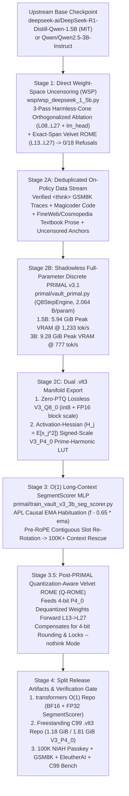

# End-to-End Pipeline & Reproduction Guide (`VAULT v3 + PRIMAL v3.1 + WSP`)

This guide documents **every step, script, artifact, and command** required to either:
- **Path A:** Run our prebuilt models immediately in freestanding C99 (`>= 1.5 GB RAM`, zero Python runtime) or Python `transformers` (`O(1)` `100K+` context), or
- **Path B:** Reproduce the **entire training, uncensoring, quantization, `SegmentScorer`, and packaging pipeline from scratch** starting from upstream Hugging Face base weights.

---

## 1. End-to-End Pipeline Architecture



---

## 2. Hardware & Software Prerequisites

| Workflow | Minimum Hardware | Software Needed | Typical Time |
|---|---|---|---|
| **C99 CPU Inference (`1.5B V3_P4_0`)** | Any `x86_64` or `ARM64` CPU, **`2 GB RAM`** (`1.47 GiB` RSS) | `gcc` or `clang`, `make` (**zero** Python/libc math deps) | `3 seconds` to compile (`53.9 tok/s` on 24T CPU) |
| **C99 CPU Inference (`3B V3_P4_0`)** | Any `x86_64` or `ARM64` CPU, **`3 GB RAM`** (`2.18 GiB` RSS) | `gcc` or `clang`, `make` | `3 seconds` to compile (`27.8 tok/s` on 24T CPU) |
| **Python `transformers` `O(1)` `100K+` Inference** | `6 GB VRAM` (`1.5B`) or `8 GB VRAM` (`3B`) GPU (or CPU/MPS) | Python `3.10+`, `pip install -r requirements.txt` | Flat `4.13 GiB` (`1.5B`) / `6.84 GiB` (`3B`) VRAM out to `100K+` tok |
| **Full Pipeline Build (`DeepSeek-1.5B` from scratch)** | **`8 GB+` CUDA / ROCm GPU** (peaks at **`5.94 GiB` VRAM**!) | Python `3.10+`, `gcc`/`clang`, `pip install -r requirements.txt` | `~30–45 min` end-to-end (incl. full 200-item `<think>` GSM8K & 100K eval) |
| **Full Pipeline Build (`Qwen-3B` from scratch)** | **`12–16 GB` CUDA / ROCm GPU** (peaks at **`9.28 GiB` VRAM**) | Python `3.10+`, `gcc`/`clang`, `pip install -r requirements.txt` | `~45–60 min` end-to-end |

### Environment Setup

```bash
git clone https://github.com/batteryphil/VAULT-v3-PRIMAL.git
cd VAULT-v3-PRIMAL

python3 -m venv .venv
source .venv/bin/activate
pip install --upgrade pip
pip install -r requirements.txt
```

> **AMD ROCm Note:** On RDNA 3 / RDNA 4 GPUs (e.g., RX 7900 / RX 9060 XT / RX 9070 XT), install the official PyTorch ROCm wheel first (`pip install torch --index-url https://download.pytorch.org/whl/rocm6.2`), then `pip install -r requirements.txt`. All pipeline scripts automatically set `TORCH_ROCM_AOTRITON_ENABLE_EXPERIMENTAL=1` and sanitize unsupported allocator flags.

---

## 3. Path A — Instant Prebuilt Inference (1 Command)

You do **not** need to re-train anything to run the finished models. Use [`run_pipeline.py`](../run_pipeline.py) at the repository root:

### A1. Freestanding C99 CPU Inference (`V3_P4_0` Prime-Harmonic LUT)

```bash
# 1. Uncensored DeepSeek-R1-1.5B-PRIMAL (1.18 GiB V3_P4_0) — full <think> step-by-step math reasoning:
python3 run_pipeline.py --mode quickstart-c99 --model deepseek-1.5b \
  --prompt "Solve step by step: Find all integer solutions to x^2 - y^2 = 15."

# 2. Uncensored DeepSeek-R1-1.5B-PRIMAL — instant zero-latency --nothink mode:
python3 run_pipeline.py --mode quickstart-c99 --model deepseek-1.5b --nothink \
  --prompt "What happened in Tiananmen Square in Beijing on June 4, 1989?"

# 3. VAULT-v3-3B-PRIMAL (1.81 GiB V3_P4_0) — chat or speed/RSS benchmark:
python3 run_pipeline.py --mode quickstart-c99 --model qwen-3b --bench 128 --threads 16
```

Or invoke `./runtime/vault3_host` directly with no Python wrapper at all:

```bash
make -C runtime
# Interactive or single-turn CLI flags:
./runtime/vault3_host ./dist/vault_v3_deepseek_r1_1_5b_p4_0_primal.vlt3 \
  --chat "Prove that sqrt(2) is irrational." \
  --n 512 --threads 12

# Available vault3_host flags:
#   --chat "<text>"       Format prompt using model's native chat template (ChatML or DeepSeek <｜User｜>)
#   --prompt "<text>"     Raw unformatted prompt string
#   --prompt-file <path>  Stream arbitrarily long prompt (e.g. 100K+ tokens) from file in O(1) memory
#   --nothink             Inject empty <think>\n</think>\n\n for instant zero-latency answers (DeepSeek)
#   --seg-budget <N>      Override O(1) Segment Memory KV slot budget (default: 1024; 0 disables bank)
#   --noseg               Ablation mode: disable SegmentScorer bank (pure sliding window + sinks)
#   --noshingle           Disable lexical shingle / Hop-2 resonance head bias
#   --temp <float>        Sampling temperature (0.0 = deterministic greedy argmax)
#   --n <int>             Max tokens to generate
#   --bench <int>         Measure exact prefill/decode tok/s and Linux VmHWM process RSS
#   --threads <int>       Worker pthreads for SIMD GEMV (AVX2+FMA / ARM64 NEON / scalar)
```

### A2. Python `transformers` Inference (`O(1)` `100K+` Segment KV Memory)

```bash
python3 run_pipeline.py --mode quickstart-python --model deepseek-1.5b \
  --prompt "Find the remainder when 7^2026 is divided by 100."

python3 run_pipeline.py --mode quickstart-python --model deepseek-1.5b --nothink \
  --prompt "Is Taiwan a de facto independent country? Answer directly."
```

### A3. Exporting to Stock `vLLM` / `Ollama` / `llama.cpp` (`Qwen2ForCausalLM` Compatibility)

Both Hugging Face repositories include `tools/export_qwen2_compat.py`, which strips the `SegmentScorer` shard (and remaps `model.lm_head.weight -> lm_head.weight` on untied models) into a standard `Qwen2ForCausalLM` folder:

```bash
git clone https://huggingface.co/batteryphil/VAULT-v3-DeepSeek-R1-1.5B-PRIMAL
python3 VAULT-v3-DeepSeek-R1-1.5B-PRIMAL/tools/export_qwen2_compat.py \
  --src VAULT-v3-DeepSeek-R1-1.5B-PRIMAL \
  --out ./qwen2_compat_deepseek_1_5b
```
*(Note: stock `Qwen2ForCausalLM` engines use standard `O(L)` KV caches and do not run VAULT v3's `O(1)` `SegmentScorer` or pre-RoPE `100K+` re-rotation.)*

---

## 4. Path B — Full End-to-End Pipeline From Scratch

### Option 1: Single-Command Automated Build (`run_pipeline.py`)

Preview every stage and exact command first with `--dry-run`, then execute:

```bash
# Preview all stages & commands:
python3 run_pipeline.py --mode full-build --model deepseek-1.5b --dry-run
python3 run_pipeline.py --mode full-build --model qwen-3b --dry-run

# Run full build from upstream Hugging Face base weights:
python3 run_pipeline.py --mode full-build --model deepseek-1.5b
```

---

### Option 2: Manual Stage-by-Stage Execution (`VAULT-v3-DeepSeek-R1-1.5B-PRIMAL`)

Below is what each stage does, what files it reads, and what artifacts it produces:

#### Stage 0 — Build & Audit the Freestanding C99 Runtime
```bash
make -C runtime
```
- **Verifies:** `0` external undefined symbols (`nm -u`) across pure scalar C99 (`-ffreestanding -nostdlib`), `x86_64 AVX2+FMA`, and `AArch64 NEON` (`clang -Werror`).
- **Produces:** `runtime/vault3_host`.

#### Stage 1 — Direct Weight-Space Uncensoring (`WSP`)
```bash
python3 -u wsp/wsp_deepseek_1_5b.py \
  --base-model deepseek-ai/DeepSeek-R1-Distill-Qwen-1.5B \
  --save-dir ./models/deepseek-r1-1.5b-wsp
```
- **Method:**
  1. **3-Pass Anisotropy-Free Subspace Ablation (`L08..L27` + untied `lm_head`):** Projects out the harmless residual cone $\hat{\mu}_{\text{har},\ell}$ and top-6 neutral math/code PCA axes before removing rank-2 refusal/apology/propaganda writers from `mlp.down_proj`, `self_attn.o_proj`, and `lm_head`.
  2. **Post-Ablation Exact-Span Velvet ROME (`L13..L27`):** Solves closed-form ridge-regularized (`gamma_preserve = 14.0`) rank-k updates across full trajectory token spans (`take_per_item = len(tokens) + 1`), unlocking empty-`<think>` (`--nothink`) mode.
  3. **18-Probe Verification Gate:** Enforces `0 / 18` refusal/hijack violations, `PPL drift <= 1.12x` (`1.055x` actual), and `100%` math CoT preservation before saving.
- **Produces:** `./models/deepseek-r1-1.5b-wsp/` (`model.safetensors`, tokenizer, and `wsp_surgery_report.json`).

#### Stages 2, 3, 3.5 & 4 — `PRIMAL v3.1` + `V3_P4_0` + `SegmentScorer` + `Q-ROME` + Full Verification
```bash
WSP_MODEL_DIR=./models/deepseek-r1-1.5b-wsp python3 -u primal/run_deepseek_1_5b_primal_pipeline.py
```
This script is **checkpoint-resumable** (caching intermediate streams and checkpoints under `./runs/deepseek_r1_1_5b_primal/`) and executes five sub-stages automatically:
1. **Stage 2A (Deduplicated Stream):** Generates test-deduplicated, verified-correct on-policy `<think>...</think>` GSM8K traces from the WSP model and packs them with `Magicoder-OSS-Instruct-75K`, `FineWeb-Edu`, `Cosmopedia-v2`, and uncensored historical/direct anchors (`runs/deepseek_r1_1_5b_primal/deepseek_1_5b_primal_stream.pt`).
2. **Stage 2B (`PRIMAL v3.1` Discrete Training):** Streams all `339` tensors (`1,776,943,104` discrete parameters including untied `lm_head.weight`) into shadowless `V3_Q8_0` (`3.415 GiB` persistent state = `2.064 B/param`) and trains with lossless error-feedback votes (`decay = 1.00`, `aux_lr = 0.0`, virtual-weight-invariant dynamic block rebalancing) inside **`5.94 GiB` peak GPU VRAM** at **`~1,233 tok/s`**, healing `WikiText-2` Word PPL (`99.20 -> ~60.6`) while preserving `GSM8K` `<think>` accuracy.
3. **Stage 2C (Dual `.vlt3` Export):**
   - Exports exact zero-PTQ `V3_Q8_0` (`dist/vault_v3_deepseek_r1_1_5b_q8_0_primal.vlt3`, `1.77 GiB`).
   - Collects activation-Hessian diagonals $H_j = \mathbb{E}[x_j^2]$ across all linear inputs and exports signed-scale `V3_P4_0` Prime-Harmonic LUT (`dist/vault_v3_deepseek_r1_1_5b_p4_0_primal.vlt3`, `1.18 GiB`, keeping 6:1 GQA `k_proj`/`v_proj`, boundary `L0,1,26,27` `q_proj`/`o_proj`, `embed_tokens`, and `lm_head` in `Q8_0`).
4. **Stage 3 (`O(1)` `SegmentScorer` Training & Repack):** Trains the `1.18M`-parameter FP32 `SegmentScorer` (`seg_layers = (8, 16, 24)`, `window = 1024`, `seg_budget = 1024`) on `50%` future cross-attention salience + `50%` contrastive fact/prose margin through exact APL causal EMA habituation (`99.97%` AUC), then repacks both `.vlt3` files (`345` tensors, CRC32-verified).
5. **Stage 3.5 (`Q-ROME`) & Stage 4 (HF Packaging + Full Eval):** Runs Quantization-Aware Post-PRIMAL Velvet ROME across `L13..L27` (feeding `4-bit P4_0` dequantized weights forward layer-by-layer so later layers compensate for 4-bit rounding), packages `dist/hf_vault_v3_deepseek_r1_1_5b/` and `dist/hf_vault_v3_deepseek_r1_1_5b_vlt3/`, and runs the full verification suite (`16K / 32.9K / 100.4K` NIAH passkey across `10% / 25% / 50%` depths, `WikiText-2`, `GSM8K-200`, `ARC-Easy`, `ARC-Challenge`, `SciQ`, uncensored audit, and 24-thread C99 benchmarks), saving `benchmarks/results/vault_v3_deepseek_r1_1_5b_primal_full_report.json`.

#### Stage 5 — Generate Model Cards (and Optional Hugging Face Upload)
```bash
# Write README.md model cards into both dist/hf_vault_v3_deepseek_r1_1_5b* folders:
python3 tools/upload_hf_deepseek_1_5b.py --cards-only

# (Optional) Upload to your own Hugging Face account after `huggingface-cli login`:
python3 tools/upload_hf_deepseek_1_5b.py
```

---

### Option 3: Manual Stage-by-Stage Execution (`VAULT-v3-3B-PRIMAL`)

```bash
# 1. Build freestanding C99 host binary:
make -C runtime

# 2. Train 3B SegmentScorer MLP (seg_layers = 10, 20, 30):
python3 -u primal/train_vault_v3_3b_seg_scorer.py --out_dir runs/vault_v3_3b_seg_scorer

# 3. Run On-Policy CoT Stream + Shadowless PRIMAL v3.1 (3.09B) + Hessian V3_P4_0 Export + Full 9-Task Eval:
python3 -u primal/run_primal_v3_1_onpolicy_and_controls.py

# 4. Package split Hugging Face repositories (dist/hf_vault_v3_3b & dist/hf_vault_v3_3b_vlt3):
python3 -u tools/build_hf_vault_v3_3b.py

# 5. Run O(1) 8K -> 100.5K Long-Context & External RULER 4K -> 64K Verification:
python3 -u benchmarks/bench_vault_v3_3b_o1_100k.py
python3 -u benchmarks/bench_ruler_and_hop2_ablation.py
```

---

## 5. Verification & Regression Test Suite

Run the standalone verification checks at any time:

```bash
# 1. Freestanding C99 symbol audit + VLT3 / BPE / C99-vs-PyTorch logit parity suite:
python3 run_pipeline.py --mode verify

# 2. Freestanding C99 8.5K 26-Needle eviction torture test (26/26 SEG ON vs 0/26 --noseg):
python3 benchmarks/run_c99_8k_26needles.py

# 3. Cross-compiled AArch64 NEON (`vqtbl1q_s8` + `vfmaq_f32`) bit-exact parity test (requires clang + qemu-aarch64):
clang --target=aarch64-linux-gnu -O3 -static benchmarks/test_arm64_neon_parity.c -lm -o benchmarks/test_arm64_neon_aarch64
qemu-aarch64 ./benchmarks/test_arm64_neon_aarch64
```

---

## 6. Porting the Pipeline to Another `Qwen2` / `Qwen2.5` / `DeepSeek-Distill` Model

Any model using the `Qwen2` GQA architecture (tied **or** untied `lm_head.weight`, ChatML **or** DeepSeek `<｜User｜>` special tokens) works natively across Python, PRIMAL, `.vlt3`, and freestanding C99:
1. **(Optional) Uncensor in Weight Space:** Point `wsp/wsp_deepseek_1_5b.py --base-model <repo_or_dir>` (adjust `ablate_layers` and `rome_layers` proportionally to `num_hidden_layers`, e.g., `~30%..100%` depth for ablation and `~45%..100%` depth for ROME).
2. **Train in Shadowless `PRIMAL v3.1`:** `VAULTPrimalConfig.from_qwen_config(qc)` automatically detects `tie_word_embeddings` (`True` or `False`), `rope_theta`, GQA head ratios, and dimensions, allocating `2.064 B/param`.
3. **Train `SegmentScorer`:** Pick 3 evenly spaced interior layers (`~28%, 56%, 85%` depth, e.g. `(8, 16, 24)` for 28L or `(10, 20, 30)` for 36L) and pack into `.vlt3` (`window = 1024, seg_budget = 1024`).
4. **Export & Run in C99:** `tools/export_vlt3.py --qwen_dir <dir> --seg_ckpt <pt> --format p4_0 --out model_p4_0.vlt3` produces a single-file binary immediately runnable by `./runtime/vault3_host`.
